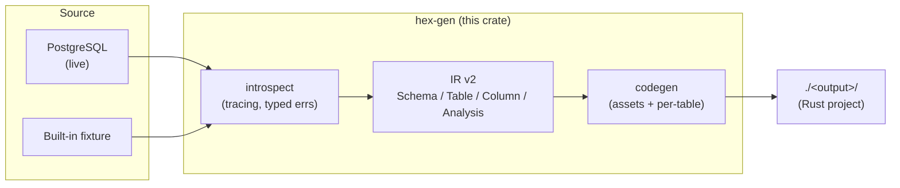

# ARCHITECTURE.md

<!--// Copyright 2025 β ORI Inc. Canada. All Rights Reserved.
// Author: Awase Khirni Syed-->
## Overview

`hex-arch-gen` v2 is a **db-first code generator** that introspects a
PostgreSQL schema and emits a compiling hexagonal-architecture Rust REST API.
The generated project matches the v0.6.0 desired-state platform's layered
structure (presentation / application / domain / infrastructure) plus the
cross-cutting concerns (shared / core / patterns / security / api /
telemetry / logging / config).

## Pipeline

> v0.5.0 (closes G-L13): the pipeline diagram is now available as both
> the ASCII art below and as a Mermaid block. The Mermaid source
> renders natively on GitHub, GitLab, and most modern markdown
> viewers, and can be re-rendered to PNG/SVG via
> `mermaid-cli` (`mmdc -i ARCHITECTURE.md -o pipeline.png`) without
> manual redrawing.

### ASCII (legacy)

```
┌──────────────────┐   ┌───────────────┐   ┌──────────────────┐   ┌──────────────┐
│  PostgreSQL      │ → │  introspect   │ → │       IR v2      │ → │   codegen    │
│  (live) OR       │   │  (tracing,    │   │  Schema/Table/   │   │  (assets +   │
│  fixture         │   │   typed errs) │   │  Column/Analysis │   │   per-table) │
└──────────────────┘   └───────────────┘   └──────────────────┘   └──────┬───────┘
                                                                         │
                                                                         ▼
                                                              ┌──────────────────┐
                                                              │  ./<output>/     │
                                                              │  (Rust project)  │
                                                              └──────────────────┘
```

### Mermaid (re-renderable)



The Mermaid source above is the canonical pipeline diagram. Any
change to the generator's pipeline should be reflected in the
Mermaid block first, then mirrored in the ASCII art for viewers
that do not render Mermaid.

## Layered architecture (generated project)

```
                    ┌─────────────────────────────────────┐
                    │   presentation/                     │   inbound adapters
                    │   handlers, routes, middleware      │
                    └────────────────┬────────────────────┘
                                     │ calls
                    ┌────────────────▼────────────────────┐
                    │   application/                      │   use-cases
                    │   services, dto, ports              │
                    └────────────────┬────────────────────┘
                                     │ depends on
                    ┌────────────────▼────────────────────┐
                    │   domain/                           │   the hexagon core
                    │   entities, value objects           │   (no framework deps)
                    └────────────────┬────────────────────┘
                                     │ implemented by
                    ┌────────────────▼────────────────────┐
                    │   infrastructure/                   │   outbound adapters
                    │   persistence (SQLx), bus, db pool  │
                    └─────────────────────────────────────┘
```

## Cross-cutting concerns

| Module            | Responsibility                                                    |
|-------------------|-------------------------------------------------------------------|
| `shared/`         | `AppError`, `AppResult`, `Pagination`, `PageResponse`.           |
| `config/`         | Typed `Settings` loaded by the `config` crate.                   |
| `logging/`        | `tracing` subscriber init (verbosity, JSON toggle).              |
| `telemetry.rs`    | OTLP/Prometheus (stub).                                           |
| `core/`           | `error_codes`, `ids`, `clock`, `aggregate`, `unit_of_work`,      |
|                   | `shutdown`, `startup`, `bulkhead`, `saga`, `chaos`, `events`,    |
|                   | `value_objects/{email, id, money}`.                              |
| `patterns/`       | `idempotency`, `outbox_worker`, `outbox_dlq`, `circuit_breaker`, |
|                   | `retry`, `pagination`, `filtering`, `webhooks`, `cache`,         |
|                   | `feature_flags`, `load_shed`.                                    |
| `security/`       | `rls`, `gdpr`, `pii`, `secrets`, `headers`, `tenancy`,           |
|                   | `auth/{extractor, jwt, refresh, dev_token, rbac, api_key}`.      |

## Error taxonomy

The generator uses a typed `GenError` enum (`src/errors.rs`) — every failure
surfaces through this taxonomy, never a panic or bare `String`:

- `MissingDatabaseUrl` — live mode without `DATABASE_URL`.
- `InvalidProjectName` — name fails the crate-name regex.
- `DbConnect` / `CatalogQuery` — PostgreSQL introspection failures.
- `NoPrimaryKey` / `NoUsableTables` — schema-level constraints.
- `UnsupportedType` — column type fell back to `String`.
- `OutputExists` — `--force` not supplied.
- `CodegenNoPk` / `TemplatePlaceholder` — defensive codegen errors.
- `Io` — filesystem failure with the offending path.
- `Other` — escape hatch via `anyhow::Error`.

Every error carries enough structured context to be actionable without
grepping logs. All errors are recorded in `ERROR_INVENTORY.md` per the
master software-engineering prompt.

## Logging & tracing

The generator bootstraps `tracing` as its first action (`src/logging.rs`).
Every codegen step is wrapped in a span; every error is logged with its full
chain before the process exits. Verbosity is derived from `-v` / `RUST_LOG`;
JSON output is enabled with `--json-logs`.

## Testing

- `tests/smoke.rs` — runs the full pipeline in fixture mode into a tempdir
  and asserts the canonical project files exist + the IR features are
  detected.
- The generated sample project is itself a test: `cargo check` on
  `generated-sample/` confirms zero errors.

## Regeneration

Edit the schema, re-run the generator with `--force`, and the artefacts are
refreshed. Manual edits inside generated files will be lost — extend the
generator templates (in `src/codegen/`) instead.
